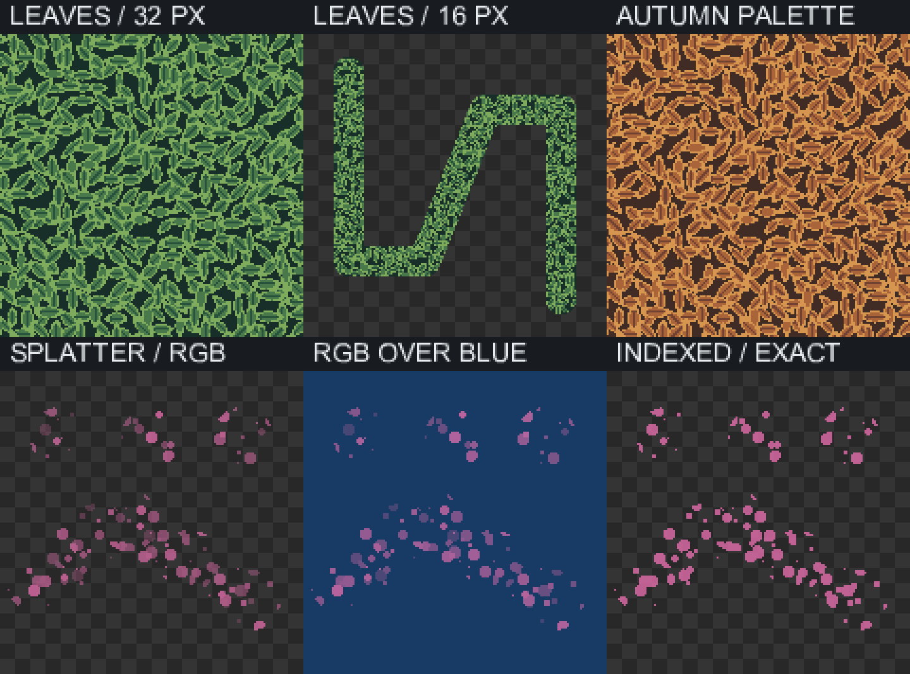

# Leaves and Splatter



The sheet is rendered by the real Dart `EditorEngine`, not a drawing mockup.
Reproduce it with `dart tool/new_brush_preview.dart` after `flutter pub get`.
CI uploads the same output as `leaves-splatter-preview`.

- **Leaves** (Textures): seeded, overlapping pointed leaves with dark interiors,
  fine veins and lighter rims. The current palette's Oklab-related ramp supplies
  every shade; the tool never invents palette colors. Brush size scales leaf detail.
  The field is canvas-anchored, including bends, repeated dabs and mirrored overlaps.
- **Splatter** (Brushes): distinct round droplets of different sizes, not continuous
  Spray. RGB/grayscale opacity varies between roughly 25–100% of the chosen alpha.
  Overlapping droplets use their strongest coverage and blend source-over once
  against the pre-stroke image. Indexed mode instead preserves the exact selected
  entry, including duplicate indices and palette alpha. Zero alpha is a no-op.

Both use the production engine for live previews, respect the selected frame and
editable layer, support horizontal/vertical symmetry and undo as one stroke.

## Focused checks

```sh
flutter test test/leaves_brush_test.dart test/splatter_brush_test.dart \
  test/new_brush_preview_test.dart test/tool_groups_test.dart
# Native pixel-for-pixel parity (after preparing the Android build):
dart tool/brush_interop.dart /tmp/spritedawg-dart-brush-interop
(cd android && SPRITEDAWG_BRUSH_INTEROP_DIR=/tmp/spritedawg-dart-brush-interop \
  ./gradlew :app:testDebugUnitTest)
```

The six sample panels show a 32 px green Leaves patch, 16 px bent stroke,
an autumn palette, RGB Splatter over transparency, RGB Splatter over blue,
and exact-alpha indexed Splatter. All use fixed seeds for reproducibility.
